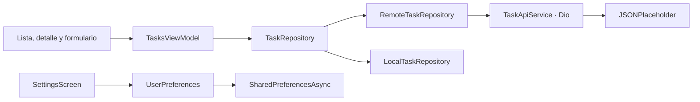
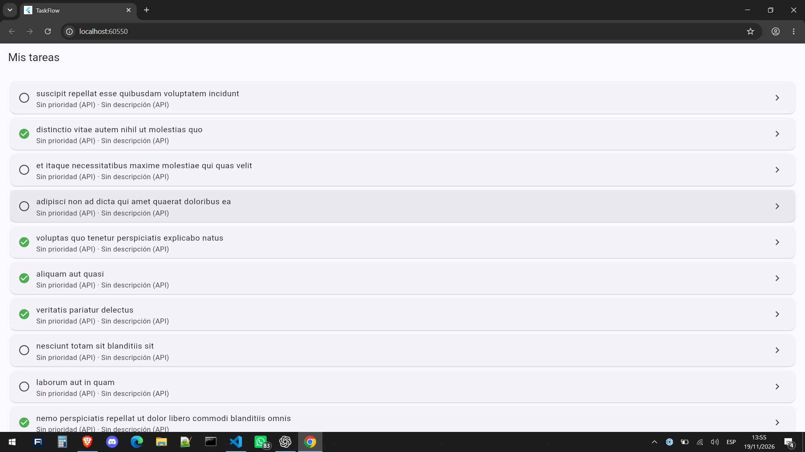
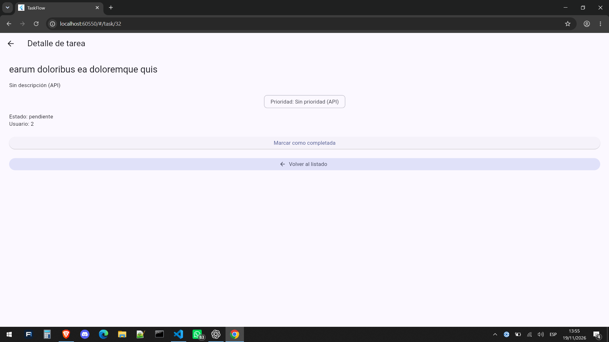
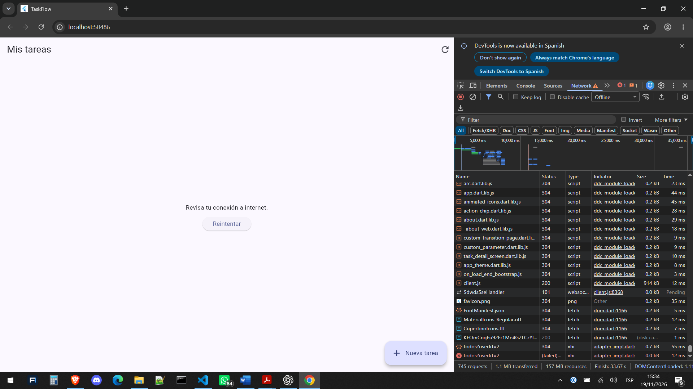
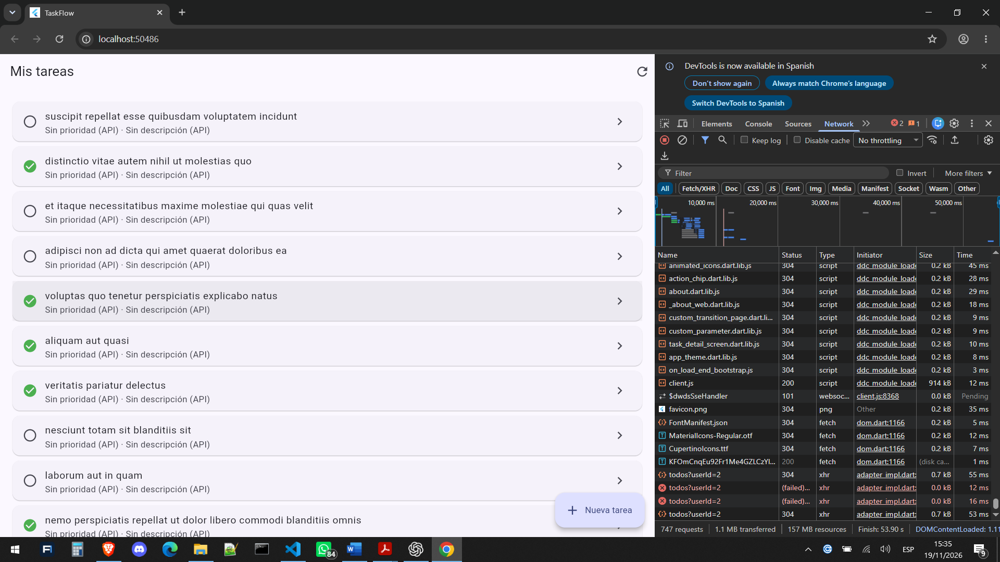
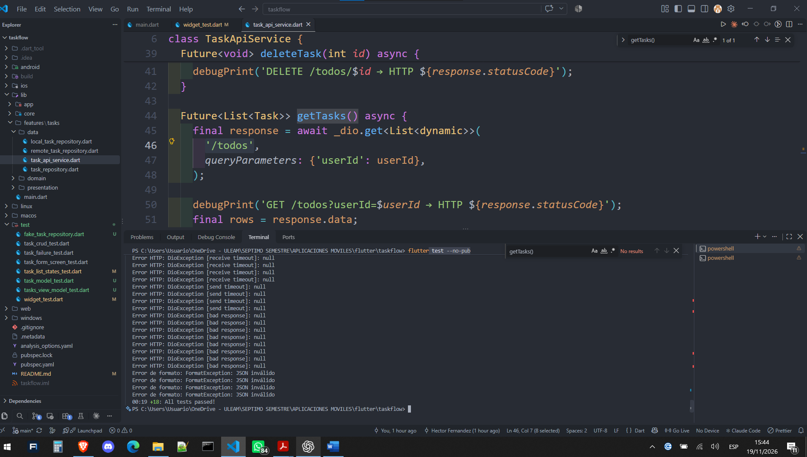
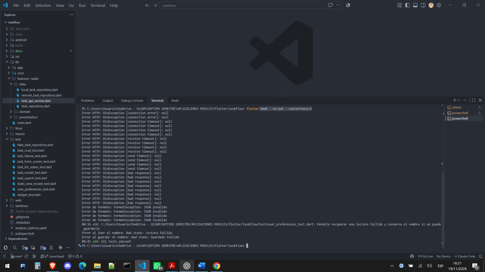
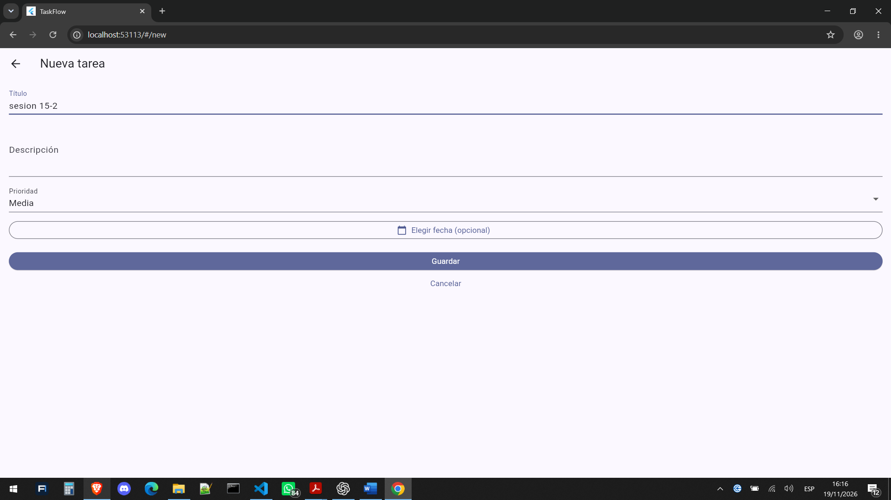

# TaskFlow

Aplicación Flutter para estudiantes que organizan sus tareas académicas.
Consulta tareas por HTTPS, muestra su detalle y permite practicar creación,
edición y eliminación con JSONPlaceholder. Incluye búsqueda, filtro de pendientes,
recuperación de errores y una preferencia local para el nombre.

## Entrega final — sesión 16

La [presentación escrita](docs/entrega-final.md) reúne la explicación del proyecto,
cuatro capturas del APK en Android, los resultados de verificación y sus
limitaciones. Incluye la descarga del [APK release](docs/apk/taskflow-release.apk),
instalado y probado en un Pixel 6 emulado con Android 15.

## Requisitos

- Flutter SDK con Dart compatible con `^3.13.7`, según `pubspec.yaml`.
  Esta entrega se comprueba con Flutter 3.47.8 y Dart 3.13.7.
- Git y conexión a internet para instalar dependencias y consultar la API.
- Chrome para ejecutar la versión web.
- Para Android, Android SDK y un emulador iniciado o teléfono conectado con
  depuración habilitada. El proyecto configura Java 17.
- En Windows, Flutter puede solicitar Modo desarrollador para crear los enlaces
  de los plugins al resolver dependencias.

## Instalación y ejecución

Clonar el repositorio y abrir la carpeta del proyecto.

```powershell
git clone https://github.com/hxctxrfdxz/flutter-hector.git taskflow
cd taskflow
flutter pub get
flutter devices
```

Para Chrome, iniciar un servidor con puerto fijo.

```powershell
flutter run -d web-server --web-port 7357 --no-pub
```

Abrir [TaskFlow en localhost](http://localhost:7357) en una ventana habitual de
Chrome y mantener la terminal abierta. El mismo navegador y puerto permiten
comprobar el nombre recordado. La terminal acepta `R` para Hot Restart y `q`
para detener la ejecución.

Para Android, conectar el dispositivo o iniciar el emulador y ejecutar.

```powershell
flutter run
```

Elegir el dispositivo Android cuando Flutter lo solicite. La aplicación necesita
conexión para cargar las tareas. El manifest principal ya declara
`android.permission.INTERNET`.

## Arquitectura y archivos principales

La aplicación organiza las tareas por funcionalidad mediante MVVM.



| Ruta | Responsabilidad |
| --- | --- |
| `lib/main.dart` | Construye el repositorio remoto y entrega un ViewModel compartido con Provider. |
| `lib/app/taskflow_app.dart` | Configura MaterialApp y las rutas con go_router. |
| `lib/core/app_theme.dart` | Centraliza el tema de la aplicación. |
| `lib/core/task_failure.dart` | Representa mensajes de error comprensibles. |
| `lib/core/settings_screen.dart` y `lib/core/user_preferences.dart` | Guardan y recuperan la preferencia del nombre. |
| `lib/features/tasks/domain/task.dart` | Modelo inmutable, conversión JSON y copyWith. |
| `lib/features/tasks/data/` | Contrato del repositorio, implementaciones local y remota y servicio HTTP. |
| `lib/features/tasks/presentation/` | ViewModel, pantallas, formulario y controles de búsqueda. |
| `test/` | Pruebas de modelos, ViewModel, widgets y fakes controlados. |

Las vistas muestran datos y llaman al ViewModel. El repositorio gestiona la
fuente de datos. El servicio concentra las solicitudes HTTP y el modelo convierte
el JSON. Provider reconstruye las vistas al recibir notifyListeners.

| Ruta de la app | Pantalla |
| --- | --- |
| `/` | Mis tareas, búsqueda, filtros y actualización. |
| `/task/:id` | Detalle, cambio local de estado, edición de título y eliminación. |
| `/new` | Nueva tarea con validación y fecha opcional. |
| `/settings` | Configuración del nombre local. |

## Calidad y comprobación de entrega

Ejecutar desde la raíz del proyecto después de instalar las dependencias.

```powershell
dart format lib test
flutter analyze --no-pub
flutter test --no-pub
git diff --check
```

Las pruebas cubren inicio, lista y detalle, validación, CRUD, fallos y reintento,
prevención de envíos duplicados, filtros y preferencias mediante datos controlados.

En la comprobación de la sesión 15, el formato terminó sin cambios, el análisis
mostró `No issues found!`, las 24 pruebas terminaron con `All tests passed!` y
`git diff --check` finalizó sin errores. El servidor web respondió con HTTP 200.

- [x] Inicio y consulta HTTP comprobados durante el desarrollo.
- [x] Navegación entre lista y detalle cubierta por pruebas.
- [x] Creación, edición y eliminación con confirmación y mensajes de éxito o error.
- [x] Recuperación de una carga fallida mediante Reintentar.
- [x] Búsqueda, filtros y preferencias cubiertos por pruebas.
- [x] Análisis estático y conjunto de pruebas aprobados.
- [x] Incorporar una captura del formulario válido.
- [ ] Revisión por otra persona siguiendo únicamente esta instalación.

## Capturas de las sesiones

Estas imágenes proceden de las evidencias compartidas durante el curso.
Los controles incorporados después de cada captura se describen en las secciones
de funcionalidades y pueden variar respecto de esas imágenes históricas.

### Listado remoto, sesión 7



### Detalle remoto, sesión 7



### Error de conexión y recuperación, sesión 11





### Pruebas aprobadas, sesión 12



### Pruebas aprobadas, sesión 15



Los mensajes de error de esta ejecución corresponden a fallos simulados dentro
de las pruebas. El resultado final confirma que las 24 comprobaciones pasaron.

### Formulario válido, sesión 15



El título es válido, la prioridad seleccionada es Media y la descripción y fecha
se mantienen como campos opcionales.

## Alcance de TaskFlow

**Problema.** Las actividades académicas y sus entregas pueden quedar dispersas
entre apuntes y mensajes. TaskFlow reúne los pendientes y las tareas completadas
en una sola lista para facilitar la planificación semanal.

**Usuario objetivo.** Estudiantes que organizan sus actividades y entregas
académicas.

El listado local de cinco tareas de la sesión 5 se conserva en el repositorio
local. La ejecución actual consulta tareas remotas y permite crear, editar
el título y eliminar mediante la API de práctica.

### Historias de usuario y criterios de aceptación

| Historia de usuario | Criterio de aceptación |
| --- | --- |
| Como estudiante, quiero listar mis tareas para identificar qué me falta. | Cada tarjeta muestra el título, la prioridad y un icono que distingue entre pendiente y completada. |
| Como estudiante, quiero consultar el detalle de una tarea para saber qué debo hacer. | Al tocar una tarjeta se abre su descripción completa, prioridad, estado e identificador de usuario. |
| Como estudiante, quiero crear una tarea para registrar un nuevo pendiente. | Al guardar un formulario válido, aparece una nueva tarea pendiente en la lista. |
| Como estudiante, quiero editar una tarea para corregir sus datos o actualizar su estado. | Al guardar cambios, la lista y el detalle muestran los datos actualizados. |
| Como estudiante, quiero eliminar una tarea que ya no necesito para mantener mi lista al día. | Al confirmar la eliminación, la tarea desaparece de la lista. Si cancelo, permanece. |

### Modelo de datos y contrato JSON

| Campo de `Task` y clave JSON | Tipo Dart | Significado |
| --- | --- | --- |
| `id` | `int` | Identificador único de la tarea. |
| `title` | `String` | Título breve para el listado. |
| `description` | `String` | Descripción completa de la actividad. |
| `priority` | `String` | Alta, Media o Baja. |
| `isCompleted` | `bool` | `true` indica completada y `false` indica pendiente. |
| `userId` | `int` | Identificador del usuario propietario. Los datos locales usan el usuario de prueba 1. |

`Task.fromJson` acepta el formato local con seis campos y el formato remoto
descrito en «API de tareas».

### Boceto de pantallas

| Pantalla | Elementos de arriba hacia abajo |
| --- | --- |
| **Mis tareas** | Barra con actualizar y configuración → búsqueda y filtro → tarjetas → Nueva tarea. |
| **Detalle de tarea** | Título, descripción, prioridad, estado y usuario → marcar estado, editar título, eliminar y volver. |
| **Formulario** | Nueva tarea → título, descripción, prioridad y fecha opcional → Guardar o Cancelar. |

### Requisitos no funcionales

- Las pantallas y los controles deben tener nombres claros en español.
- Un identificador inválido o inexistente debe mostrar un mensaje y permitir
  volver al listado.

### Operaciones de la API utilizada

| Método y ruta | Operación |
| --- | --- |
| `GET /todos?userId=2` | Cargar las tareas del usuario elegido. |
| `POST /todos` | Simular la creación de una tarea. |
| `PATCH /todos/:id` | Simular la actualización del título y estado enviados. |
| `DELETE /todos/:id` | Simular la eliminación de una tarea. |

El detalle usa el id de la ruta de la app para buscar una tarea ya cargada.
JSONPlaceholder es la fuente seleccionada desde la sesión 7.

## API de tareas

Desde la sesión 7, TaskFlow obtiene tareas de JSONPlaceholder usando Dio.
La URL exacta elegida para esta práctica es
[https://jsonplaceholder.typicode.com/todos?userId=2](https://jsonplaceholder.typicode.com/todos?userId=2).
La constante `TaskApiService.userId = 2` selecciona las tareas del usuario 2
como adaptación del ejemplo guiado, que usa el usuario 1.

| Campo recibido | Campo de TaskFlow |
| --- | --- |
| `id` | `id`, identificador de la tarea. |
| `title` | `title`, título que aparece en lista y detalle. |
| `completed` | `isCompleted`, estado pendiente o completada. |
| `userId` | `userId`, identificador del propietario. |

La API entrega esos cuatro campos. TaskFlow completa `description` con
«Sin descripción (API)» y `priority` con «Sin prioridad (API)» cuando faltan.
Estos textos son valores predeterminados de la aplicación.

`TaskApiService` conoce la URL y realiza el GET. `Task.fromJson` convierte cada
objeto JSON en una tarea. `RemoteTaskRepository` conserva una copia en memoria.
`TasksViewModel.loadTasks` espera la respuesta y notifica a las vistas mediante
Provider. La consola registra `GET /todos?userId=2 → HTTP 200` cuando la consulta
termina correctamente. Durante la espera se muestra un indicador de carga y,
si falla, muestra el mensaje de TaskFailure correspondiente.

Marcar una tarea como completada o pendiente modifica la copia local en memoria.
Al reiniciar la app o volver a cargar desde la API se recuperan los valores del
servidor. Desde la sesión 10 también se realizan POST, PATCH y DELETE simulados.

Las cinco tareas propias de la sesión 6 siguen en `LocalTaskRepository`, que
también implementa el contrato asíncrono `Future<List<Task>>`.

## Estados de la lista y reintento

En la sesión 8, la lista distingue carga, tareas disponibles, respuesta vacía
y error. La acción «Actualizar tareas» de la barra y el gesto de deslizar hacia
abajo repiten la consulta. Mientras hay una petición activa, el botón queda
deshabilitado y el ViewModel evita iniciar otra consulta simultánea.

Para comprobar cada estado en Chrome con `flutter run -d chrome`, seguir este
procedimiento.

| Estado | Cómo provocarlo | Resultado esperado |
| --- | --- | --- |
| Datos disponibles | Mantener internet activo y `TaskApiService.userId = 2`, iniciar la app o pulsar «Actualizar tareas». | Aparecen las tareas remotas y cada tarjeta abre su detalle. |
| Carga | En DevTools de Chrome, abrir Network, seleccionar Slow 3G y pulsar «Actualizar tareas». | Aparece el indicador de progreso y se deshabilita el botón de actualización. Al finalizar se presenta la respuesta. |
| Error | Con DevTools abierto, seleccionar Offline en Network y pulsar «Actualizar tareas». | Aparece «Revisa tu conexión a internet.» junto a «Reintentar». |
| Recuperación | Tras el error, cambiar Offline a No throttling y pulsar «Reintentar». | Las tareas vuelven sin reiniciar TaskFlow. |
| Vacío | Cambiar temporalmente `TaskApiService.userId` a `9999` y hacer Hot Restart. | La API devuelve una lista vacía y aparecen «Todavía no hay tareas para mostrar.» y «Actualizar». |

Al terminar la comprobación de vacío, restaurar `userId = 2`, hacer Hot Restart
y dejar Network en No throttling. Para la evidencia se necesitan capturas del
listado, del vacío y del error, además de comprobar la recuperación con Reintentar.
Una respuesta vacía se considera válida. Un fallo limpia las tareas anteriores
y muestra el error. Actualizar vuelve a leer el servidor y recupera sus estados
originales para las tareas marcadas localmente.

## Formulario de tareas

La sesión 9 incorpora «Nueva tarea», accesible desde el botón del listado y la
ruta `/new`. El formulario prepara un `TaskDraft` con título, descripción,
prioridad y fecha opcional.

- El título es obligatorio y necesita al menos tres caracteres después de
  quitar espacios al principio y al final.
- La descripción es opcional.
- La prioridad permite Alta, Media o Baja, con Media seleccionada al abrir.
- «Elegir fecha (opcional)» abre el calendario. «Quitar fecha» permite retirarla.
- Guardar envía el formulario válido y, tras una respuesta correcta, regresa al
  listado con «Tarea creada».
- Cancelar o usar la flecha de regreso descarta el borrador sin mostrar ese aviso.

El formulario se conectó a POST en la sesión 10. Desde la sesión 11 espera la
respuesta con Guardar deshabilitado y conserva los campos ante un fallo.

Para comprobarlo, intentar guardar con un título vacío, uno de dos caracteres y
uno válido. Verificar el guardado con y sin fecha, la selección de prioridad,
la cancelación y el acceso al detalle de las tareas existentes.
La evidencia de la sesión incluye capturas de errores de validación, formulario
válido y mensaje de retorno al listado.

## CRUD de tareas

Guardar prepara el borrador y llama al ViewModel para enviarlo mediante
`POST /todos`. La tarea aparece después de recibir una respuesta correcta,
con el mensaje «Tarea creada». El título y la descripción se envían al repositorio
junto con la prioridad. El servicio envía a la API título, estado y usuario.
Descripción y prioridad se conservan en memoria.

En el detalle, «Editar título» abre un diálogo con el título actual.
El nuevo título necesita al menos tres caracteres. Guardar envía
`PATCH /todos/:id` con título y estado. Si la respuesta es correcta, lista y
detalle muestran el nuevo título y aparece «Tarea actualizada».

«Eliminar tarea» pide confirmación. Cancelar conserva la tarea.
Confirmar envía `DELETE /todos/:id`; tras una respuesta correcta, la tarea
desaparece y se regresa al listado con «Tarea eliminada».
Una operación fallida muestra su mensaje de error y conserva los datos anteriores.

JSONPlaceholder simula las escrituras. Al actualizar la lista o reiniciar,
vuelven los datos originales. Los títulos creados y editados no se guardan
permanentemente. Para comprobar edición, usar una tarea recibida por GET:
un id devuelto por POST puede no existir en el servidor para un PATCH posterior.
Si POST repite un identificador ya usado, el repositorio asigna el siguiente
id libre en la copia en memoria para distinguir las nuevas tarjetas.

La fecha opcional forma parte del borrador del formulario de la sesión 9.
El contrato de creación de esta práctica conserva título, descripción y prioridad.
El cambio con «Marcar como completada/pendiente» mantiene su comportamiento local.

Para la evidencia, tomar capturas antes y después de crear una tarea, editar
el título de una tarea existente y confirmar su eliminación. Comprobar también
la cancelación y un fallo de red: el error debe mostrar el aviso correspondiente.

## Manejo de errores y control de envíos

En la sesión 11, el repositorio remoto traduce los errores de consulta, creación,
edición y eliminación a `TaskFailure`. Las pantallas muestran mensajes
comprensibles y los detalles técnicos quedan en la consola.

| Situación | Mensaje |
| --- | --- |
| Fallo de conexión | Revisa tu conexión a internet. |
| Tiempo de conexión, envío o respuesta agotado | El servidor tardó demasiado. |
| Respuesta HTTP de error | La API respondió con HTTP 404, 500 u otro código recibido. |
| Formato o tipos inesperados | La API devolvió datos inesperados. |
| Fallo no previsto | Ocurrió un problema inesperado. |

`isSaving` bloquea nuevos envíos durante crear, editar y eliminar, y se libera
en `finally` tanto si la operación funciona como si falla. Guardar muestra
«Guardando...» y queda deshabilitado mientras espera. Un fallo de creación o
edición conserva los campos para permitir corregirlos o repetir la acción
manualmente. Las consultas pueden recuperarse con Reintentar. No se repite POST
automáticamente, ya que una repetición podría duplicar una tarea.

Para las evidencias en Chrome, comprobar estos casos.

1. Abrir DevTools → Network y seleccionar Offline. Pulsar «Actualizar tareas»,
   capturar «Revisa tu conexión a internet.» y el botón Reintentar.
2. Seleccionar No throttling y pulsar Reintentar. Capturar la lista recuperada.
3. Para simular una respuesta HTTP de error, cambiar temporalmente la ruta
   `'/todos'` de `getTasks` en `TaskApiService` por `'/ruta-inexistente'`,
   guardar y hacer Hot Restart. Capturar el mensaje con el código HTTP recibido.
4. Restaurar la ruta `'/todos'`, guardar y hacer Hot Restart para recuperar la lista.

Para observar el bloqueo de Guardar, seleccionar Slow 3G en Network y guardar
un formulario válido. Restaurar No throttling al terminar. La versión final
usa `/todos`, `userId = 2` y los límites de red originales.

## Pruebas automatizadas

La sesión 12 reúne las cuatro áreas de prueba solicitadas, adaptadas al usuario 2,
los mensajes personalizados y el contrato CRUD actual.

| Área | Archivo | Comprobación |
| --- | --- | --- |
| Modelo JSON | `test/task_model_test.dart` | Convierte `completed` al estado del modelo, completa descripción y prioridad ausentes y conserva el formato local. |
| Estado del ViewModel | `test/tasks_view_model_test.dart` | Una lista vacía se distingue de un error. Un fallo limpia los datos anteriores y un reintento los recupera. |
| Validación del formulario | `test/task_form_screen_test.dart` | Rechaza títulos vacíos y de dos caracteres. Permite guardar datos válidos con fecha opcional y cancelar sin confirmación. |
| Carga y error en la lista | `test/task_list_states_test.dart` | Muestra carga, error, Reintentar y vacío con Actualizar. Recupera las tareas y comprueba la actualización por gesto. |

`test/fake_task_repository.dart` implementa el contrato completo del repositorio
con datos en memoria. Permite simular éxito, vacío y un `TaskFailure` controlado.
Las pruebas de widget proporcionan el ViewModel mediante Provider, como la app.
Las otras pruebas existentes siguen comprobando navegación, CRUD y prevención
de envíos duplicados.

Ejecutar desde la raíz del proyecto.

```powershell
flutter analyze
flutter test
```

Las pruebas usan repositorios locales, fakes y respuestas controladas. Pueden
ejecutarse sin conexión una vez instaladas las dependencias. Si las dependencias
ya están resueltas, usar `flutter test --no-pub` para evitar su resolución.
La evidencia de esta sesión es una captura de la terminal con todas las pruebas
aprobadas y el mensaje `All tests passed!`.

## Preferencia del nombre

La sesión 13 agrega Configuración, accesible desde el engranaje de Mis tareas
y la ruta `/settings`. `UserPreferences` utiliza `SharedPreferencesAsync` para
leer y escribir el nombre bajo la clave `user_name`. Al no existir un nombre
guardado, muestra «Estudiante». Guardar quita los espacios de los extremos,
rechaza nombres vacíos y confirma con «Nombre guardado».

El nombre es una preferencia local del dispositivo o navegador. La API continúa
consultando las tareas del usuario 2. Esta preferencia no representa una sesión
autenticada ni contiene credenciales.

Para comprobar la persistencia en Chrome, mantener el mismo perfil y la misma
dirección con puerto fijo. Desde la raíz del proyecto, ejecutar este servidor
y abrir la dirección en una ventana normal de Chrome.

```powershell
flutter run -d web-server --web-port 7357 --no-pub
```

Abrir [TaskFlow en localhost](http://localhost:7357), entrar en Configuración,
escribir el nombre y guardar. Tomar la primera captura con la confirmación.
Cerrar la pestaña de TaskFlow y volver a abrir la misma dirección. Entrar en
Configuración y tomar la segunda captura con el nombre recuperado.
Mantener la terminal del servidor abierta durante la comprobación.

Chrome almacena esta preferencia por origen, que incluye el puerto. Cambiar de
puerto, perfil o limpiar los datos del sitio puede cambiar el almacenamiento
disponible para la aplicación.

## Búsqueda, filtros y accesibilidad

La sesión 14 agrega «Buscar por título», el interruptor «Solo pendientes» y
«Limpiar filtros». La búsqueda ignora mayúsculas y espacios en los extremos.
Texto y estado se combinan sobre las tareas ya cargadas en el ViewModel.
Filtrar conserva la lista original y no realiza nuevas consultas a la API.

Si los filtros no coinciden con ninguna tarea, aparece «No hay resultados para
estos filtros.». Limpiar borra el campo y desactiva Solo pendientes para recuperar
la lista completa. El mensaje de respuesta vacía de la API sigue siendo
«Todavía no hay tareas para mostrar.».

El controlador de búsqueda conserva el texto y el cursor durante las
reconstrucciones. La lista tiene espacio acotado mediante Expanded y mantiene
su desplazamiento y actualización por gesto. Los botones de icono tienen tooltip
y los estados incluyen iconos distintos con etiquetas «Tarea completada» y
«Tarea pendiente» para lectores de pantalla.

Para comprobar la práctica, buscar una parte del título en mayúsculas, activar
Solo pendientes, escribir un texto sin coincidencias y pulsar Limpiar filtros.
Verificar que se recupera la lista y que el detalle abre la tarea elegida.
Las pruebas incluyen una pantalla de 320 × 640 con texto ampliado al 200 %.
La evidencia consiste en capturas con los filtros activos y después de limpiarlos.
