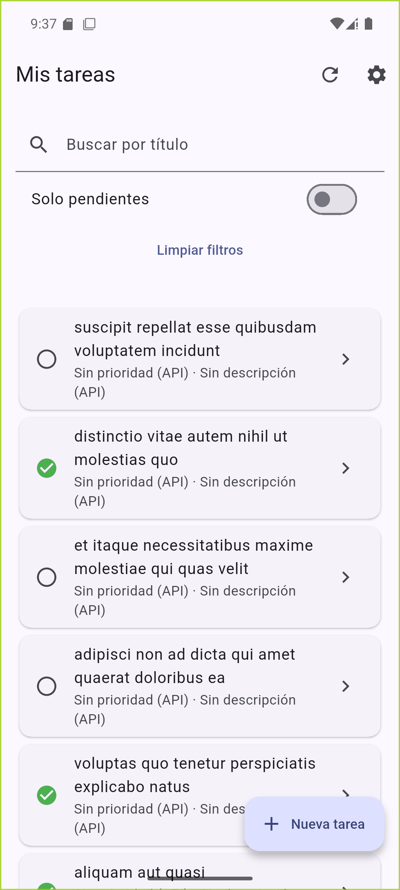
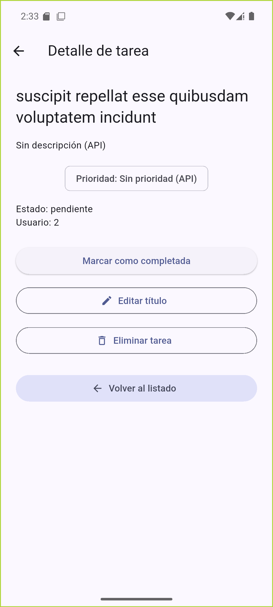
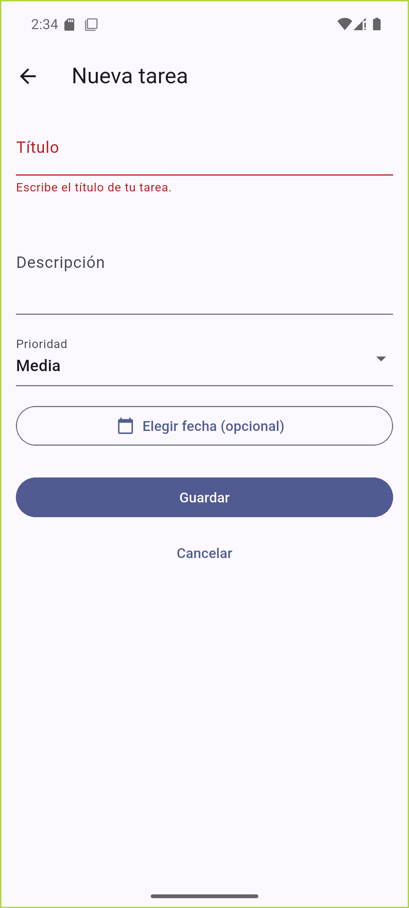
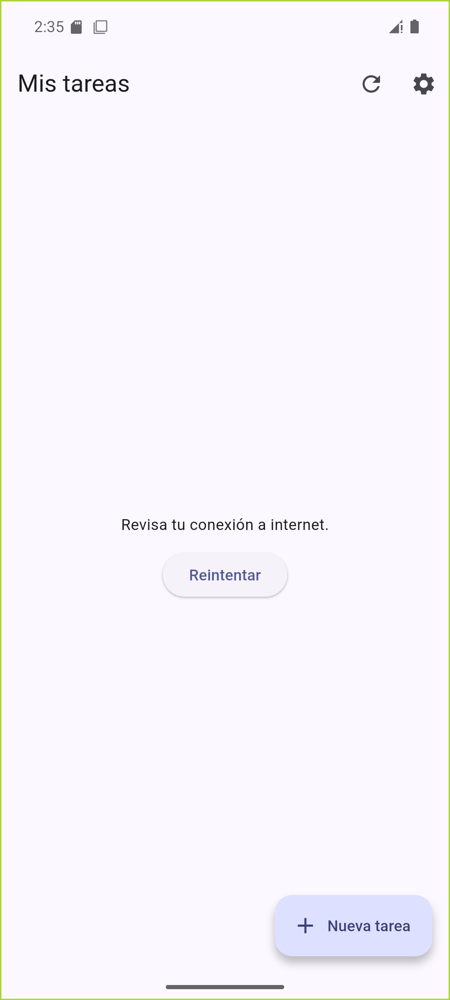

# Presentación escrita de TaskFlow

## Proyecto

- Repositorio del curso en [GitHub](https://github.com/hxctxrfdxz/flutter-hector).
- La aplicación reúne tareas académicas para consultar pendientes y organizar
  entregas. Permite buscar, revisar detalles y practicar creación, edición y
  eliminación con una API REST.
- El usuario objetivo es un estudiante que planifica sus actividades semanales.
- La entrega incluye un APK release instalado y comprobado en un emulador
  Pixel 6 con Android 15 (API 35).
- El historial del repositorio reúne 16 commits, desde la bienvenida hasta
  el cierre de la entrega final.

## APK e instalación

[Descargar TaskFlow 1.0.0 para Android](https://github.com/hxctxrfdxz/flutter-hector/raw/refs/heads/main/docs/apk/taskflow-release.apk)

El archivo también está en [docs/apk/taskflow-release.apk](apk/taskflow-release.apk).
Requiere Android 7.0 (API 24) o posterior, ocupa aproximadamente 51.8 MiB e
incluye las arquitecturas ARM de 32 y 64 bits y x86_64. Para instalarlo desde
Android, descargarlo, abrirlo y permitir la instalación desde esa fuente cuando
el sistema lo solicite. Con un dispositivo de pruebas conectado por ADB:

```powershell
adb install -r docs/apk/taskflow-release.apk
```

SHA-256 del APK:
`940F78FC568C81D6DC1FD0A79083396A0DE16A07839FBBBD9B761696D3D2544A`.

## Resultado de la aplicación

### Listado remoto



La aplicación presenta las tareas consultadas por HTTP con su estado.

### Detalle de tarea



Al abrir una tarjeta, su id permite recuperar título, descripción, prioridad,
estado y usuario desde las tareas cargadas.

### Formulario



El formulario exige un título de al menos tres caracteres y permite introducir
descripción, prioridad y una fecha opcional.

### Error recuperable



La lista explica el fallo de conexión y ofrece Reintentar para recuperarse.
Las cuatro capturas corresponden al APK release de esta entrega, ejecutado en
Android. La lista volvió a mostrarse al restablecer la conexión y reintentar.

## Verificación final

Se ejecutaron los siguientes comandos con Flutter 3.47.8 y Dart 3.13.7:

```powershell
dart format lib test
flutter analyze --no-pub
flutter test --no-pub --concurrency=1
flutter build apk --release --no-pub
```

Resultado: 27 archivos formateados sin cambios, análisis sin problemas,
24 pruebas aprobadas (`All tests passed!`) y APK release generado correctamente.
La ejecución secuencial evita el conflicto de caché de pruebas observado en
Windows dentro de OneDrive.

En el emulador se instaló ese mismo APK y se comprobó el recorrido: cargar
la lista remota, abrir el detalle, marcar una tarea como completada, volver al
listado, abrir Nueva tarea, intentar guardar sin título, completar un título
válido y guardar. La aplicación confirmó «Tarea creada». También se desactivó
la conexión del emulador, se actualizó la lista y se comprobó el mensaje de
error; al restablecer la conexión y pulsar Reintentar se recuperaron las tareas.
La conexión del emulador quedó restablecida.

## Cómo funciona

- La arquitectura sigue el recorrido View → ViewModel → Repository →
  TaskApiService → API. Provider comunica los cambios a las pantallas.
- La consulta usa `GET https://jsonplaceholder.typicode.com/todos?userId=2`.
  Crear envía `POST /todos`, editar envía `PATCH /todos/:id` y eliminar envía
  `DELETE /todos/:id`.
- Dio maneja HTTP. `Task.fromJson` adapta `completed` a `isCompleted` y completa
  descripción y prioridad cuando faltan.
- La comprobación final del código terminó con formato sin cambios, análisis
  sin problemas y 24 pruebas aprobadas. Las pruebas controlan JSON, navegación,
  formulario, CRUD, errores, reintento, filtros y preferencias.
- Los fallos de red, tiempo agotado, HTTP y formato producen mensajes distintos.
  Guardar permanece deshabilitado durante un envío.
- Configuración guarda el nombre mediante SharedPreferencesAsync bajo la clave
  `user_name`.

## Limitaciones conocidas

JSONPlaceholder simula las escrituras. Actualizar o reiniciar recupera los datos
originales del servidor. Descripción y prioridad se conservan en memoria, y la
fecha opcional pertenece al borrador del formulario. La edición remota de tareas
recién creadas puede fallar porque el servidor no conserva sus ids.

El nombre guardado es una preferencia local. La app consulta las tareas del
usuario de prueba 2. La compilación conserva la firma de desarrollo configurada
en el proyecto para la entrega académica.
